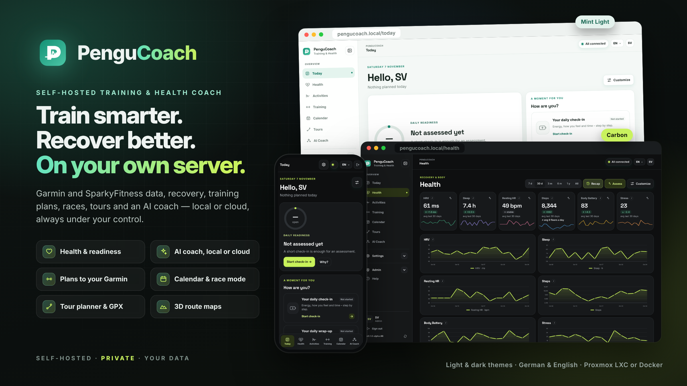

# PenguCoach

<p align="center">
  
</p>

**Self-hosted AI Training & Health Coach** · **Selbst gehosteter KI-Trainings- und Gesundheitscoach**

> **Development project / Entwicklungsprojekt.** PenguCoach analyses fitness, training and wellness data. It is not a medical device and does not replace qualified medical, sports, physiotherapy or nutrition advice. Every new login requires confirmation of the Development & Health Notice.

PenguCoach runs on your own server (Proxmox LXC or Docker). It reads Garmin Connect and/or SparkyFitness, imports FIT/GPX/TCX files, calculates its numbers deterministically and only then lets a local or cloud AI interpret them – with cloud access to health data switched off until you allow it.

What changed in each version: **[CHANGELOG](CHANGELOG.md)** · in the app under *Admin → System & updates*.

## Highlights

| | |
|---|---|
| **Today** | Readiness lamps, check-in and wrap-up, weather windows, race countdown – every card optional and movable. [More](docs/TODAY_FLOW.md) |
| **Health** | HRV, sleep, resting HR, steps, floors, Body Battery, stress and body composition with trends, plain explanations and an animated recap. Missing days stay missing. [More](docs/HEALTH_DEVELOPMENT.md) |
| **Activities** | Charts, splits, route explorer with **3D terrain and flyover**, route briefing and comparison, showcase images and recaps. [More](docs/ACTIVITY_ROUTE_EXPLORER.md) |
| **Tour planner** | Loops or A→B tours for road bike, gravel, MTB, touring, running, trail running and hiking – three variants with elevation profile, surface mix and estimated time, export as GPX for Garmin, Komoot and others. No API key. [More](docs/TOUR_PLANNER.md) |
| **Training** | AI training plans with a weekly calendar, plan review against what you actually did, and opt-in export of structured workouts to Garmin. [More](docs/TRAINING_WORKSPACE.md) |
| **Calendar & races** | Year heatmap, streaks, drag & drop for planned sessions, calendar subscription for phone and Outlook, race mode with prognosis and taper proposal. |
| **AI Coach** | Ollama, OpenAI, Anthropic, Gemini, OpenRouter, IONOS, xAI and OpenAI-compatible servers; per-task models, budgets and cost statistics. [More](docs/AI_STUDIO.md) |
| **Everyday** | German and English, light and dark themes (e.g. Mint Light, Carbon) or your own palette, multi-user, built-in help. |

## Data sources

- **Garmin Connect** – login with MFA (password never stored) or the official read-only Personal API key. Syncing is strictly read-only; writing is limited to the optional workout export you enable yourself. [Garmin export](docs/GARMIN_WORKOUT_EXPORT.md) · [Personal API](docs/GARMIN_PERSONAL_API.md)
- **SparkyFitness** – read-only connection to your self-hosted instance, including Apple Health data passed through it. [SparkyFitness](docs/SPARKYFITNESS.md)
- **Files** – FIT, GPX, TCX and ZIP imports without any account. Original FIT files are kept unchanged.
- **Maps and weather without keys** – OpenStreetMap, OpenTopoMap, AWS terrain tiles, BRouter (brouter.de or your own server) and Open-Meteo.

## Installation (Proxmox LXC)

Run on the **Proxmox host**:

```bash
bash -c "$(curl -fsSL https://raw.githubusercontent.com/Borderlane-HA/PenguCoach/main/install/proxmox/pengucoach.sh)"
```

The installer asks for CT ID, CPU, RAM, disk, bridge and storage (defaults: 4 vCPU, 4 GB RAM, 32 GB disk) and sets up an unprivileged Debian 13 LXC with PostgreSQL, Redis, FastAPI, Celery, Next.js and Nginx. Then open `http://<LXC-IP>/` – the first visit creates the administrator. Details: [`install/proxmox/README.md`](install/proxmox/README.md)

**Updates, backups and recovery** run from the web interface (*Admin → System & updates*) or on the console:

```bash
pct exec <CTID> -- pengucoach-update    # backup, update, migrations, health check
pct exec <CTID> -- pengucoach-backup
pct exec <CTID> -- pengucoach-status
```

See [System maintenance](docs/SYSTEM_MAINTENANCE.md).

## Docker (development or alternative setup)

```bash
cp .env.example .env
python3 - <<'PY'
import secrets
from cryptography.fernet import Fernet
print("PENGUCOACH_JWT_SECRET=" + secrets.token_urlsafe(48))
print("PENGUCOACH_ENCRYPTION_KEY=" + Fernet.generate_key().decode())
PY
# put both values into .env, then
docker compose up --build
```

Web: `http://localhost:3000` · API docs: `http://localhost:8000/docs`

## Privacy and security

- Health and training data stay on your server. Cloud AI receives them only after you allow it per user; *local AI only* prevents any cloud fallback.
- Garmin tokens, AI keys and map keys are encrypted at rest and never returned by the API.
- Numbers are calculated by PenguCoach first; the AI interprets, it does not invent values.

See [`SECURITY.md`](SECURITY.md).

## Documentation

[Today](docs/TODAY_FLOW.md) · [Health](docs/HEALTH_DEVELOPMENT.md) · [Activity detail](docs/ACTIVITY_DETAIL_V2.md) · [Route explorer & 3D](docs/ACTIVITY_ROUTE_EXPLORER.md) · [Tour planner](docs/TOUR_PLANNER.md) · [Showcase](docs/SHOWCASE.md) · [Recap](docs/RECAP.md) · [Training workspace](docs/TRAINING_WORKSPACE.md) · [Execution review](docs/TRAINING_EXECUTION.md) · [AI analysis & planning](docs/AI_ANALYSIS_AND_PLANNING.md) · [AI Studio](docs/AI_STUDIO.md) · [OpenRouter](docs/OPENROUTER.md) · [Unified data](docs/UNIFIED_DATA.md) · [Local training features](docs/LOCAL_TRAINING_FEATURES.md) · [Personalization](docs/PERSONALIZATION.md) · [GitHub upload](docs/GITHUB_UPLOAD.md) · [Roadmap](docs/ROADMAP.md)

## Repository layout

```text
apps/web/          Next.js UI
apps/api/          FastAPI API and routers
pengucoach/        Domain code (garmin, sparkyfitness, fit, imports, coach, tours, llm …)
worker/            Celery workers and scheduler
db/migrations/     Alembic migrations
install/           Proxmox LXC installer, update, backup and maintenance tools
docs/              Feature and operations documentation
tests/             Python tests (web tests live in apps/web/tests)
```

## License

Since `v0.1.0-alpha.44` PenguCoach is licensed under the **PolyForm Noncommercial License 1.0.0**: personal and other noncommercial use, modification and redistribution are allowed; commercial use, resale, paid hosting/SaaS or commercial integration need separate permission. Earlier MIT releases keep their original rights. See [`LICENSE`](LICENSE).

Garmin and Garmin Connect are trademarks of Garmin Ltd. or its subsidiaries; Komoot is a trademark of komoot GmbH. PenguCoach is an independent project and not affiliated with or endorsed by them. The Garmin integration uses the unofficial `python-garminconnect` project, which Garmin may break at any time.
