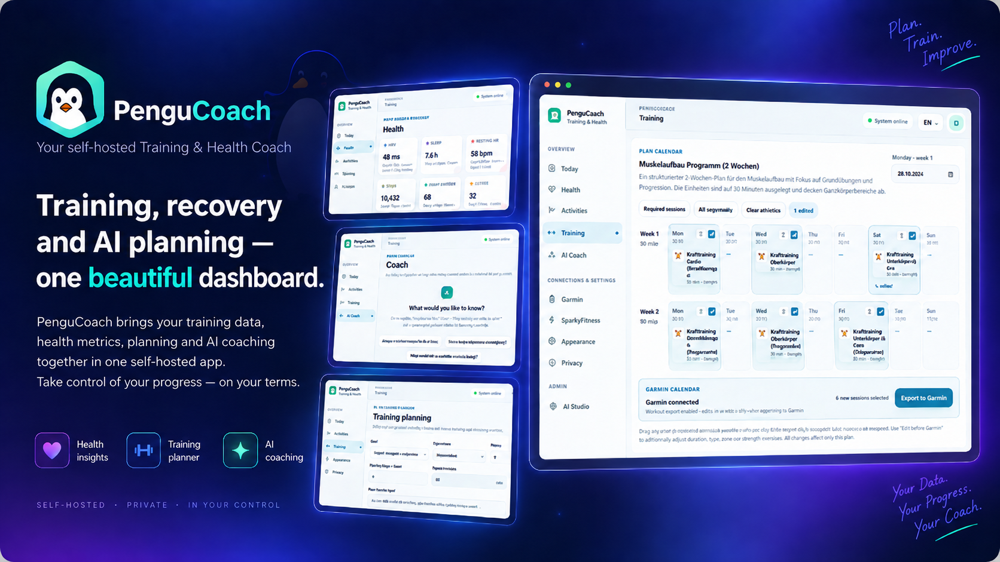

# PenguCoach

<p align="center">
  
</p>

**Self-hosted AI Training & Health Coach** · **Selbst gehosteter KI-Trainings- und Gesundheitscoach**

> **Development project / Entwicklungsprojekt.** PenguCoach analyses fitness, training and wellness data. It is not a medical device and does not replace qualified medical, sports, physiotherapy or nutrition advice. Every new login requires confirmation of the Development & Health Notice.

PenguCoach is designed as a local-first, multi-user platform that reads Garmin Connect and/or SparkyFitness data, supports manual body measurements and FIT/GPX/TCX imports, archives original FIT files, calculates deterministic activity metrics and can use local or cloud LLMs for contextual training analysis.

### Your Today flow (Alpha.53)

Morning, workout preparation and daily reflection; larger readiness lamps with an independently loaded score, body-area soreness, optional hourly weather windows, activity feedback and customizable cards. See [Today workflow](docs/TODAY_FLOW.md).

### Local training companion

Reviewed time-budget variants, confirmed training experiences, recorded 1/5/20-minute best efforts, calendar-draft load checks and a route briefing with climbs, sustained fast passages, personal GPS notes and timed-plan orientation. All calculations use available recorded data; no extra AI calls or API keys are required. See [calculation rules and workflow](docs/LOCAL_TRAINING_FEATURES.md).


**Alpha.66 maintenance update:** strengthens generation-time schemas for requested session counts, local week numbers, executable/repeat steps and strength targets. Segmented-plan technical details now retain every validation reason and show total/retry time, plus separate native Ollama loading, input and generation timings when provided. Live progress identifies retries. These changes aim to reduce unnecessary regeneration; actual savings depend on the model. Existing saved plans remain compatible. Includes the Alpha.64/65 Sparky GPS, numeric-input and training-format fixes. See [SparkyFitness setup](docs/SPARKYFITNESS.md).

## Current alpha scope

`v0.1.0-alpha.65` is the current end-to-end alpha baseline:

- **Sparky recording times and readings:** separate local clocks and recording zones, historical timestamp correction on sync, explicit time-unknown display, better minimum-HR/telemetry extraction and missing values shown as missing. See [SparkyFitness](docs/SPARKYFITNESS.md).

- **Reliable mobile number entry:** freely clear and retype weeks, training days, token limits and other numbers without jumping to a minimum. Decimal commas, optional empty values and cursor edits work consistently across the app. Failed plan generation also clears stale progress text. See [Number entry](docs/NUMBER_INPUT.md).

- **Train, review, improve:** recorded interval-level plan execution, optional ±4-hour matching, manual activity assignment, AI session reviews and reviewed adjustments for a comparable future session. Evidence also informs future AI plans. Explicit +8,000-token continuation preserves partial text and valid plan segments. See [Execution review and continuation](docs/TRAINING_EXECUTION.md).

- **OpenRouter:** native provider selection, key verification without a model request, searchable model discovery and imported context/output limits for chat, activity analysis and training plans. See [OpenRouter setup](docs/OPENROUTER.md).

- **Your training week:** a calm weekly calendar, measurable goal journey, Progress tab and reviewed “What if” adjustments; focused dialogs and collapsed plan management keep the main screen concise. See [Training workspace](docs/TRAINING_WORKSPACE.md).

- **Clearer activity analysis:** plain “7 days” context, a compact start action, expandable model settings and a full-width prompt editor with local default restoration.

- **Calmer Today:** open, selectable readings at the top; equal status tiles for guided check-in and daily wrap-up; weekly figures shown once in the weekly reflection.

- Compact navigation: collapsible Settings and Admin groups, an optional desktop icon rail, and saved sidebar preferences per browser and username.

- **Training & Progress:** recorded-sample goal review with time-weighted intervals and adjustable alignment; GPS-verified whole-route or selected-section comparison; synchronized replay; historical readiness, observed sleep/check-in patterns and personal milestones. Today prioritizes one contextual action. See [`docs/TRAINING_INSIGHTS.md`](docs/TRAINING_INSIGHTS.md).
- **Visual Readiness:** three clear traffic-light lamps, a short training action and compact strain chips. Detailed explanations and data confidence are available on demand; sparse data stays neutral.
- **Activity Route Explorer:** synchronized OpenStreetMap route and workout charts, time/distance axes, touch/keyboard position selection, metric-colored tracks and optional Google Street View / Apple Look Around after explicit consent. Each user manages their own encrypted credentials under **Settings → Maps & street view**. See [`docs/ACTIVITY_ROUTE_EXPLORER.md`](docs/ACTIVITY_ROUTE_EXPLORER.md).
- **Plan Evolution:** smarter duration-aware activity matching with reviewed shifted-day candidates and persistent one-to-one assignments; missing imports remain pending. Saved plans offer reviewed short variants and a deterministic next-seven-days editor with per-day time budgets, weather, today's recovery, protected exports and transactional Decision Log entries. Today links directly to the plan and shows data freshness. See [`docs/PLAN_EVOLUTION.md`](docs/PLAN_EVOLUTION.md).
- **Today Experience:** compact illustration-free Today hero, practical Today-in-focus card, clearer action hierarchy, refined daily recommendation flow and a theme-safe daily check-in with battery-style energy choices, soreness chips and clearly explained available-time quick selection.
- **Training Intelligence:** deterministic 7/28-day training-load trends, weekly volume and sport mix; near-term Open-Meteo badges on outdoor plan sessions; deterministic plan-conflict detection; reviewed weather-based indoor alternatives; and a persistent AI Decision Log for accepted adaptive changes.
- **Health Development:** professional interactive training/health charts, fitness and efficiency trends, sport-specific training volume, load-vs-recovery, 3/6-month views and a conservative VO₂max fallback when no provider value exists. Estimated VO₂ values are clearly labelled and never treated as clinical measurements. See [`docs/HEALTH_DEVELOPMENT.md`](docs/HEALTH_DEVELOPMENT.md).
- **Coach Memory suggestions:** PenguCoach can propose a memory only after repeated explicit evidence such as confirmed indoor adaptations or repeated very-hard workout feedback. Suggestions are never saved without confirmation and can be dismissed.
- **Noncommercial license from Alpha.44:** new releases use PolyForm Noncommercial 1.0.0. Personal and other permitted noncommercial use/modification/redistribution remain available; commercial use, resale, paid hosting/SaaS and commercial integration require separate permission. Earlier MIT releases keep their original rights.

- Running training-plan generation survives page/browser changes visibly: PenguCoach restores the active server-side job, shows a compact live status card and prevents accidentally queueing a duplicate plan.

- **Adaptive coach:** editable Coach Memory v1 profile and explicit memories, deterministic Pengu Readiness with transparent factors, daily check-ins, post-workout feedback including optional discomfort notes, and reviewed adaptive plan suggestions for missed or recovery-sensitive sessions. No plan change is applied without confirmation. See [`docs/COACH_COMPANION.md`](docs/COACH_COMPANION.md).
- **Weather-aware everyday Coach:** relevant short-range questions such as “What should I train today?”, “Should I ride tomorrow?” or direct weather questions can receive a bounded Open-Meteo snapshot. Answer details show whether weather, Readiness, plan, profile, zones and recovery data were actually supplied; the desktop **Model & response** column can be collapsed and remembered locally.
- **Guided Training Planner:** training-plan creation is a four-step Goal → Framework → Data → Review assistant. Existing plans, plan descriptions, calendars, weeks and sessions use progressive disclosure; AI model/token/prompt controls stay available under Advanced settings instead of dominating the normal workflow. The layout is responsive down to phone-sized screens.
- **Chat reliability:** content-sized bubbles, visible local streaming, reasoning disabled for Ollama requests, accurate finish-reason checks and explicit empty-response errors.
- **Unified data:** Today, Health, activity analysis, Coach and training planning use the same per-metric provenance and body snapshot. No Garmin connection is required. See [`docs/UNIFIED_DATA.md`](docs/UNIFIED_DATA.md).
- **SparkyFitness read-only connection:** configurable self-hosted URL + encrypted API key, capability probing, multi-year/all-history manual sync plus a small configurable interval sync for today + yesterday. Sleep, daily/check-in data, HRV/resting-HR custom metrics, body/scale values and paginated workout history are imported. If SparkyFitness exposes Apple Health Cardio Fitness/VO₂ as a custom metric, PenguCoach imports it as provider data instead of using its own fallback estimate. Compact history rows are enriched from SparkyFitness exercise-entry/provider details so HealthKit/Apple Health heart rate, speed, elevation, distance, duration and calories can reach the activity diary. Conservative duplicate matching merges the same Garmin/Sparky workout instead of double-counting it.


- German and English web UI
- bright health-first responsive web design with desktop sidebar and mobile navigation dock
- per-user appearance themes with pre-paint persistence to avoid navigation flashes (Mint Light, Midnight Health, Ocean, Forest, Lavender, Warm Sand, Rose, Nordic Night, Aurora, Alpine, Arctic, Espresso, Ember and Mono); dashboard metric colors are derived from the active theme for consistent contrast
- profile-picture and custom app-icon upload stored locally and included in normal backups
- built-in PenguCoach app icon used by default in the UI plus a browser favicon; a custom app icon can still override the sidebar branding
- simplified Garmin synchronization with one everyday Sync action and a separate history/backfill section
- scalable Garmin history import: offset-paginated activity catalogue plus resumable daily backfill, default optimized mode for older history, full detail for the latest 90 days, rate-limit retries, live progress and pause/cancel controls
- dedicated **activities-only catalogue completion** action showing the locally stored activity count and last catalogue scan, so incomplete 200/300-entry histories can be repaired without reloading sleep/stress/daily wellness history
- live Garmin sync state with reload-safe job polling; the Sync button stays disabled until the worker has actually finished and timestamps refresh automatically
- first-run administrator setup
- multi-user local authentication
- mandatory safety/development gate after every login
- Garmin Connect login with MFA
- encrypted Garmin token persistence; Garmin password is never stored
- allow-list based **strict read-only** Garmin data-sync gateway plus a separate opt-in, narrow workout/calendar write gateway
- configurable automatic sync with jitter, lock, 429 cooldown and reconnect state
- daily Garmin data ingestion for health, sleep, HRV, stress, Body Battery, hydration, respiration, SpO₂, intensity, training readiness/status, max metrics, body data and activities where the account/device exposes them
- body composition and profile context for AI/health views: weight, height, BMI, body-fat %, body-water %, muscle mass and bone mass from Garmin/SparkyFitness or an optional manual fallback for users without a smart scale; manual values remain active per metric until newer connected-source measurements arrive; daily steps and individual metric provenance are shown separately
- immutable original FIT download
- FIT parsing and Parquet time-series storage
- deterministic FIT analytics: HR/pace/power/cadence drift, aerobic decoupling, pace consistency and data coverage
- performance-oriented server-side activity journal: the first 25/50/100 rows load independently from source/status counters, PostgreSQL indexes accelerate the common user/date and source filters, summary counters are aggregated/cached separately, and responsive skeleton/loading states keep large 5,000+ activity histories visibly responsive; detail views retain FIT time series
- manual activity import without Garmin: FIT, GPX, TCX and ZIP-contained FIT files are stored locally, normalized into the same activity history and analysed with the same deterministic pipeline
- health overview and professional historical charts with Today / Last 7 days / This week / This month / Last 3 months / Last 6 months / This year / All filters; top health cards show averages of the available measurements in the selected period while missing days are not treated as zero
- Ollama, OpenAI, Anthropic, IONOS AI Model Hub, Google Gemini, xAI/Grok, OpenRouter and generic OpenAI-compatible provider management
- optional per-model input/output token pricing plus system-wide AI usage/cost statistics for today, 7 days, 30 days, current year and all time; local models retain token statistics even without prices
- per-function response profiles (**Very low / Low / Standard / High**) for Coach, activity analysis and training planning, with cost estimates before generation and actual token/cost snapshots after completion
- optional monthly AI cost budget indicator (informational only), per-model/per-task breakdowns, average tokens/request and measured output throughput for newly timed runs
- editable/deletable AI models plus saved-provider model discovery
- current Anthropic Models API discovery with imported Claude context/output capabilities
- cloud-health AI disabled per user by default; configuring an external provider shows the privacy requirement and offers an explicit one-click enable action; local Ollama can be used without cloud permission
- evidence-constrained Coach chat using local Garmin/FIT facts with selectable models and token budgets
- per-activity AI deep analysis with Training-only / This day / 3-day / 7-day training-recovery context and an editable predefined prompt
- AI training-plan generation for strength, muscle gain, cardio, hybrid, running, cycling, mobility and custom goals
- selectable training-plan briefing window (3/7/14/21/28 days, default 7) plus opt-in context categories for training/FIT, Garmin zones, sleep/HRV, recovery/stress and steps/hydration
- optional Open-Meteo weather context: per-user location search, current/16-day forecast preview, an opt-in training-plan factor and an independently switchable eight-day snapshot for relevant Coach questions; only explicit forecast dates are shared, later plan weeks remain weather-neutral and weather outages never block coaching/planning
- live approximate Ollama output-token progress and user cancellation for Coach, activity analysis and training-plan background jobs
- validated structured training-plan sessions/steps with weekly calendar review, optional-session selection, start-date mapping, legacy-plan management and deletion; pre-export Garmin drafts can adjust duration, steps, targets and strength exercises without mutating the AI plan
- explicit opt-in Garmin workout export for running/cycling/swimming/walking/hiking/strength plus timed cardio/mobility/yoga/Pilates/HIIT sessions, with pre-export Garmin exercise validation, searchable per-user strength mappings, a visible `Total Body` safety fallback for unknown movements, duplicate protection, reload-safe progress and optional Garmin cleanup when a plan is deleted
- task-specific default/fallback model routing, bilingual DE/EN prompts, freely configurable context windows and output-token caps with recommended presets
- clearer AI Studio fixed-model assignment indicator and compact provider/model management actions
- persisted AI analysis/plan runs plus reload-safe background AI jobs
- PostgreSQL + Redis/Celery
- Alembic schema baseline
- native Proxmox LXC installer with Debian 13 `nesting=1`, UTF-8 locale/database setup and explicit Nginx reload
- `pengucoach-update`, `pengucoach-backup`, `pengucoach-status`, `pengucoach-db-utf8`
- Docker Compose for development/alternative deployments

The ten-part Adaptive Coach direction and its shipped/partial/planned status are tracked in [`docs/ROADMAP.md`](docs/ROADMAP.md). Advanced long-term baselines, a correlation explorer and the full LangGraph multi-agent workflow remain planned work. Training-plan generation remains AI-assisted and uses only the recent context window and data categories selected for that request. Garmin write access is limited to the explicit workout/calendar export path; PenguCoach does not create or manage Garmin Coach adaptive plans.

## Proxmox installation

Requirements:

- Proxmox VE host with internet access
- root shell on the Proxmox host
- a Debian 13 LXC template available through `pveam`
- DHCP on the selected bridge, unless you adapt the installer

Run on the **Proxmox host**:

```bash
bash -c "$(curl -fsSL https://raw.githubusercontent.com/Borderlane-HA/PenguCoach/main/install/proxmox/pengucoach.sh)"
```

The installer asks for CT ID, CPU, RAM, disk, bridge and storage. Defaults are 4 vCPU, 4 GB RAM and 32 GB disk. It creates an unprivileged Debian 13 LXC, clones this repository and installs PostgreSQL, Redis, FastAPI, Celery, Next.js and Nginx natively inside the container.

After installation open:

```text
http://<LXC-IP>/
```

There is no default administrator password. The first browser session creates the administrator through `/setup`.

Detailed instructions: [`install/proxmox/README.md`](install/proxmox/README.md)

## Update

Inside the PenguCoach LXC:

```bash
pengucoach-update
```

Or directly from the Proxmox host:

```bash
pct exec <CTID> -- pengucoach-update
```

The updater creates a backup, fetches the configured Git branch, deterministically aligns the deployment checkout with `origin/<channel>` (local source edits in `/opt/pengucoach` are replaced), updates Python dependencies, applies Alembic migrations, rebuilds Next.js, restarts services and performs a health check. Runtime data, configuration, FIT/Parquet files and user assets live outside the Git checkout and are preserved.

Status:

```bash
pct exec <CTID> -- pengucoach-status
```

Manual backup:

```bash
pct exec <CTID> -- pengucoach-backup
```

Early alpha installations that still use a PostgreSQL `SQL_ASCII` database can be migrated safely with:

```bash
pct exec <CTID> -- pengucoach-db-utf8
```

## Docker development quick start

Copy the environment template and generate secrets:

```bash
cp .env.example .env
python3 - <<'PY'
import secrets
from cryptography.fernet import Fernet
print("PENGUCOACH_JWT_SECRET=" + secrets.token_urlsafe(48))
print("PENGUCOACH_ENCRYPTION_KEY=" + Fernet.generate_key().decode())
PY
```

Place the two values in `.env`, then:

```bash
docker compose up --build
```

Web: `http://localhost:3000`  
API docs: `http://localhost:8000/docs`

## Activity Detail v2

Since `0.1.0-alpha.3`, parsed FIT activities include a richer deterministic detail view before AI interpretation: interactive overlay/stacked charts, min/average/max sensor values, elevation and grade, kilometre/100 m splits, channel coverage, and sport-specific FIT lap/set/length tables when the recording device provides them. See [`docs/ACTIVITY_DETAIL_V2.md`](docs/ACTIVITY_DETAIL_V2.md).


## AI analysis and training planning

Since `0.1.0-alpha.4`, each activity can be sent to an eligible configured LLM for a deep analysis. The UI shows the effective default model, permits choosing another eligible model, supports Training-only / This day / 3-day / 7-day context scopes, and exposes the predefined analysis prompt for editing. Garmin activity totals are marked as the primary official values; locally calculated FIT analytics are supplied separately.

The Training page can generate and persist plans for muscle gain, endurance/cardio, hybrid, cycling, running race goals, strength, general fitness, mobility and custom goals. The briefing window is selectable between 3, 7, 14, 21 and 28 days (7 by default), and the user chooses whether training/FIT analytics, Garmin zones, sleep/HRV, recovery/stress and optional steps/hydration are included.

AI controls are configured in the **AI Studio**. Each task has a default/fallback model, separate German and English prompts, a configurable context window and a hard response-token ceiling. For Ollama, the context window is sent as `num_ctx` and the response budget as `num_predict`. Ollama generation is streamed through the worker so long responses are not limited by the old single-response wait timeout; the UI shows approximate live output-token progress. Long local-model generations run in the background so page reloads do not lose the job, and Coach/analysis/plan jobs can be cancelled. Local Ollama remains usable without enabling cloud-health processing.

See [`docs/AI_ANALYSIS_AND_PLANNING.md`](docs/AI_ANALYSIS_AND_PLANNING.md).

## Data flow

```text
Garmin Connect                 Manual FIT / GPX / TCX import
(read sync; optional workout export)          ↓
        ↓                              ↓
Raw source records + normalized PostgreSQL activities
        ↓
Original activity file → Parquet → deterministic analytics
        ↓
Context builder
        ↓
Ollama / OpenAI / Anthropic (subject to user privacy settings)
        ↓
PenguCoach interpretation
```

AI is deliberately near the end of the pipeline. Numbers that can be calculated deterministically are calculated by PenguCoach before an LLM sees the context.

## Garmin access policy

PenguCoach does **not** expose generic access to the Garmin client. Normal synchronization still goes exclusively through `GarminReadOnlyGateway`, an explicit allow-list of getters/download operations. Health, activity, FIT, body and training-data synchronization therefore remains read-only.

Alpha.14 adds one deliberately separate exception: `GarminWorkoutGateway`. It is disabled by default, is never passed to the AI layer, and exposes only the operations PenguCoach needs to upload a concrete structured workout, schedule it on a chosen calendar date, and delete an orphaned workout template if scheduling fails. The user must first enable **Training & Kalender → Trainingsplan zu Garmin exportieren** and then explicitly select/confirm sessions in a generated plan. An export ledger blocks duplicate session/date exports. Hydration, weight and other Garmin mutation methods remain unavailable. Before export, the calendar supports browser-local editing of workout content and drag & drop or touch-select scheduling: non-exported sessions can be moved to another day, and dropping onto an occupied day swaps both sessions. The AI-generated source plan remains unchanged.

Strength export is validated against the Garmin exercise catalogue before upload. Exact catalogue names and safe built-in aliases resolve automatically; otherwise the calendar shows the missing mapping and lets the user search Garmin's catalogue. A selected mapping is stored per user and reused for the same local/AI exercise label in later plans. If the user exports before mapping an unknown movement, only that movement falls back visibly to Garmin's real `Total Body` exercise instead of failing the complete strength workout.

The integration uses the unofficial `python-garminconnect` project. Garmin can change its private web services at any time, so both gateways are intentionally isolated and replaceable.

## Repository layout

```text
apps/web/                 Next.js UI
apps/api/                 FastAPI API and routers
pengucoach/               Domain/application code
pengucoach/garmin/        Auth, read-only sync gateway and narrow workout export gateway
pengucoach/fit/           FIT storage/parser/analytics
pengucoach/imports/       Manual FIT/GPX/TCX activity import
pengucoach/llm/           Provider adapters and routing
worker/                   Celery workers/scheduler
db/migrations/            Alembic schema migrations
install/proxmox/          LXC install/update/backup tools
docs/                     Architecture and operations docs
tests/                    Unit/integration tests
```

## Security and privacy defaults

- Garmin password is used for authentication only and is not persisted.
- Garmin token bundles and LLM API keys are encrypted at rest.
- Secrets are never returned by the API after storage.
- Cloud AI access to a user's health/training context is **off by default**.
- Local-only mode prevents silent cloud fallback.
- Exact Garmin mutation operations are not exposed.
- Health/FIT files remain local unless the user explicitly allows eligible cloud AI processing.

See [`SECURITY.md`](SECURITY.md).

## License

Starting with `v0.1.0-alpha.44`, PenguCoach is provided under the **PolyForm Noncommercial License 1.0.0**. Personal and other permitted noncommercial use, modification and redistribution are allowed under those terms. Commercial use, resale, paid hosting/SaaS or commercial product integration require separate permission from the copyright holder. See [`LICENSE`](LICENSE) and the in-app **About PenguCoach** page.

Earlier PenguCoach releases that were distributed under MIT retain the rights granted with those specific releases.

Garmin and Garmin Connect are trademarks of Garmin Ltd. or its subsidiaries. PenguCoach is an independent development project and is not affiliated with or endorsed by Garmin.


### Activity AI context scopes

Activity deep analysis supports four explicit context scopes: **Nur dieses Training / This training only**, **Dieser Tag / This day**, **3 Tage / 3 days**, and **7 Tage / 7 days**. The day/multi-day scopes include available Garmin wellness/recovery data such as sleep, HRV, resting heart rate, stress, Body Battery, Training Readiness, steps and hydration. Missing Garmin values remain null and are never invented.


### SparkyFitness

See [`docs/SPARKYFITNESS.md`](docs/SPARKYFITNESS.md) for connection setup, read-only scope, source precedence and sync behavior.
